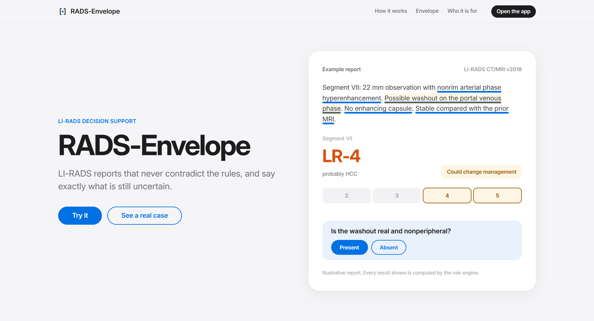
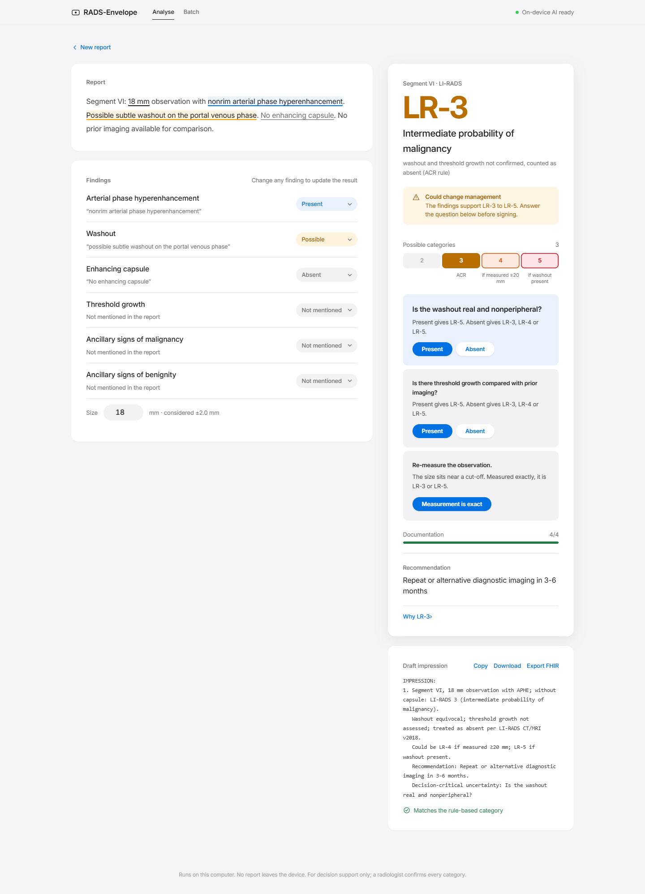
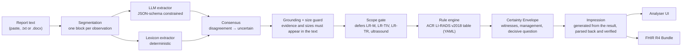
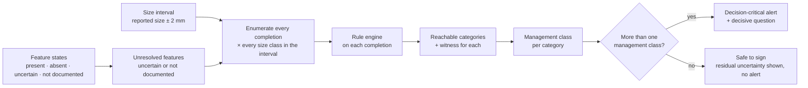
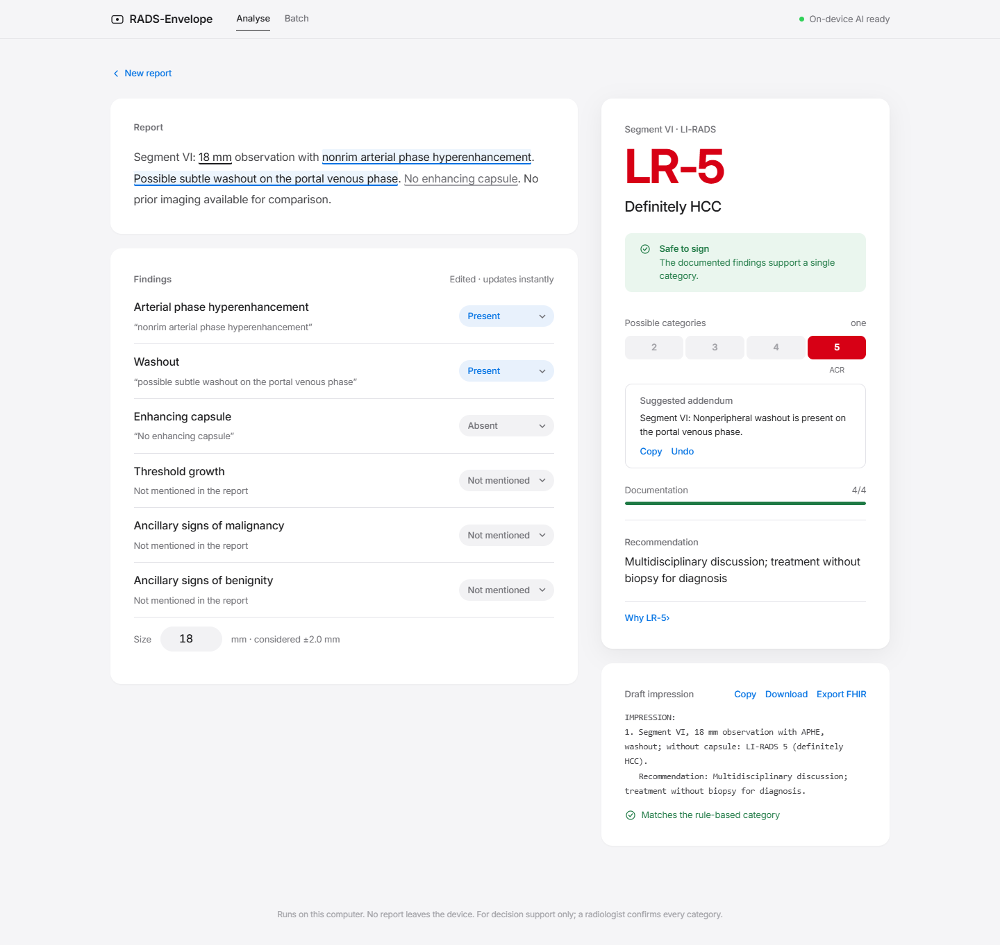
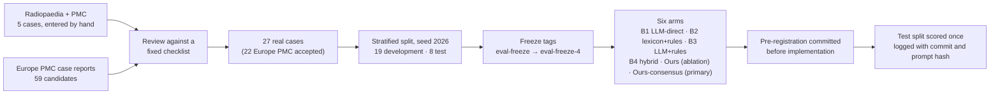
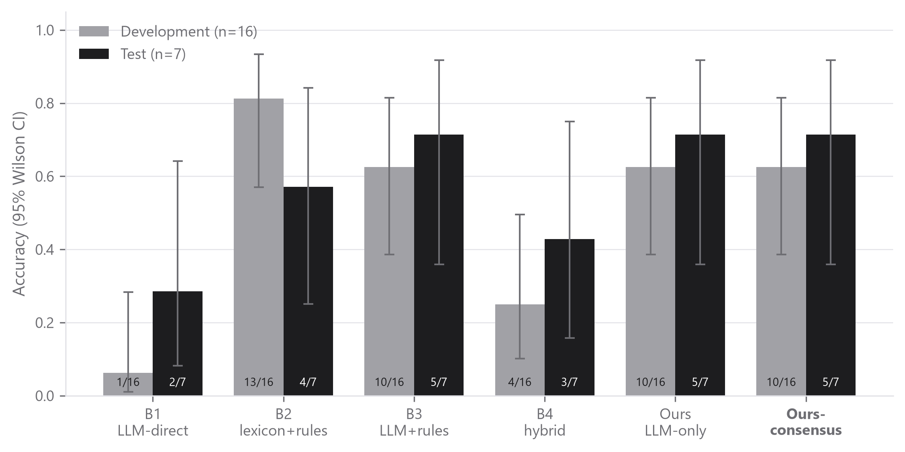
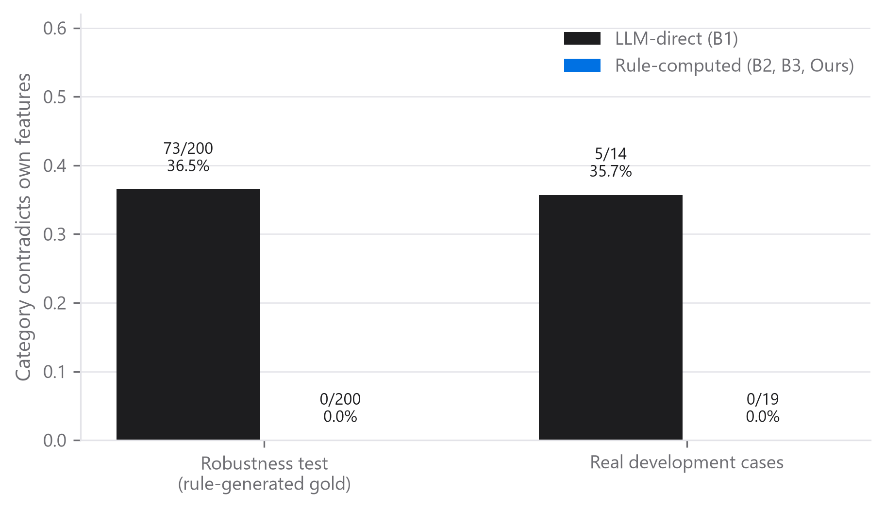
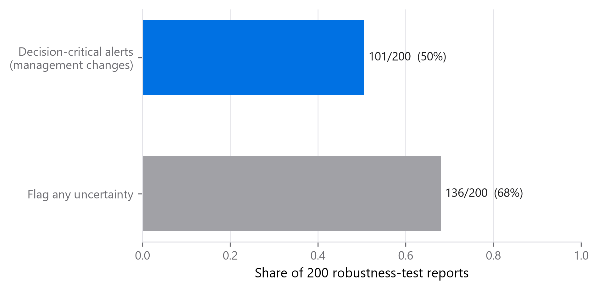
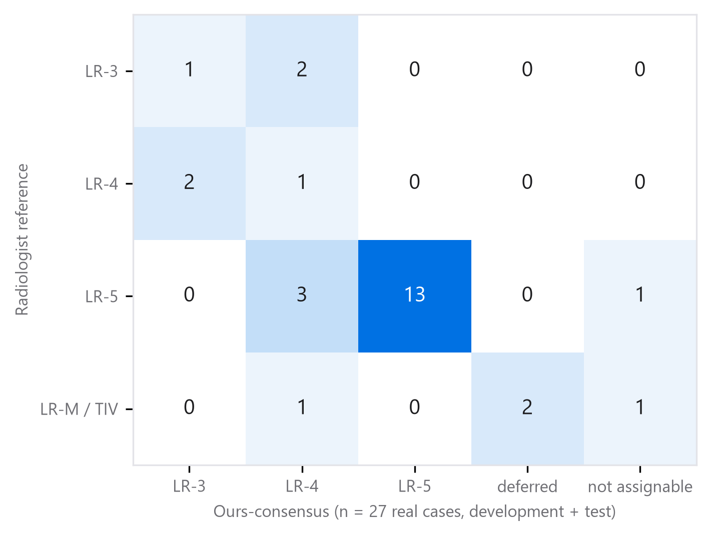

<div align="center">

# RADS-Envelope

**LI-RADS reports that never contradict the rules, and say exactly what is still uncertain.**




</div>

A local language model reads a liver CT/MRI report and fills a closed, four-state schema. The published
ACR LI-RADS v2018 table, stored as versioned data, computes the category. The **Certainty Envelope**
lists every category the findings still allow and raises an alert only when those categories lead to
different care. The impression is written from the rule result and checked against it, so the report
cannot contradict itself.

<p align="center"></p>

---

## The problem

A language model that drafts a report writes the category as free text, and nothing checks it against
the findings in the same report. Asked directly for features and a category, the same local model (B1)
contradicted the ACR table applied to **its own** extracted features in
([EVALUATION.md, Headline numbers](docs/EVALUATION.md#headline-numbers)):

| Set | Contradictions | 95% CI |
| --- | --- | --- |
| Robustness test, 200 generated reports | **73/200 = 36.5%** | 30.1–43.4% |
| Real development cases | 5/14 = 35.7% | 16.3–61.2% |
| Real held-out test cases | 3/5 = 60.0% | 23.1–88.2% |
| Real cases pooled | 8/19 = 42.1% | 23.1–63.7% |
| **RADS-Envelope** (rule-computed category) | **0/200 and 0/27** | zero by construction |

## What it does

- **Four-state extraction with evidence.** Each LI-RADS feature is *present, absent, uncertain* or *not documented*, with the verbatim words it came from. A size is accepted only if the report writes it.
- **Rule-computed category.** The ACR table, loaded from `rules/lirads_ct_mri_v2018.yaml`, decides the category and shows the decision path. The model never writes a category.
- **Certainty Envelope.** Hedged findings, undocumented features, size tolerance and disagreement between extractors become an exact set of reachable categories, each with a witness ("LR-5 if washout present").
- **Management-aware alert, decisive question, addendum.** It alerts only when the reachable categories map to different management. It asks the single question that settles it, and one click narrows the envelope and drafts the addendum sentence.
- **Report check and batch audit.** It flags finished reports whose stated category contradicts their own findings, scores documentation completeness and exports CSV.
- **Interoperable and offline.** HL7 FHIR R4 export, comparison with a prior study (threshold growth), and everything on one laptop. No report leaves the machine.

## How it works



The model (`qwen2.5:7b-instruct` through Ollama, temperature 0, fixed seed) only fills a JSON schema.
Ollama compiles that schema into a grammar, so tokens outside the allowed values are masked during
decoding. Design notes, algorithms and the guarantees each test proves: [docs/ARCHITECTURE.md](docs/ARCHITECTURE.md).

## The Certainty Envelope

The ACR tie-break (an uncertain feature counts as absent) always yields a valid category, but it hides
that a clinically different category may be one finding away. The engine evaluates every completion of
the unresolved features over the size interval, which is an exact enumeration of at most 320 rule
evaluations. It keeps the set of reachable categories and, for each, the completion with the fewest
assumptions.



**Worked example (demo report S1).**

> Segment VI: 18 mm observation with nonrim arterial phase hyperenhancement. Possible subtle washout on the portal venous phase. No enhancing capsule.

| | Before | After answering *washout: Present* |
| --- | --- | --- |
| Category | LR-3 (ACR tie-break) | LR-5 |
| Envelope | LR-3, LR-4, LR-5 | LR-5 |
| Status | Could change management: "Is the washout real and nonperipheral?" | Safe to sign |
| Addendum | – | "Segment VI: Nonperipheral washout is present on the portal venous phase." |

<p align="center"></p>

## Evaluation



Every number below is copied from [docs/EVALUATION.md](docs/EVALUATION.md), which is generated from the
committed result files. Accuracy is shown with 95% Wilson intervals. A deferral or missing category
counts as wrong.

**Real cases** ([EVALUATION.md, Results at a glance, §2, §3](docs/EVALUATION.md#results-at-a-glance-development-vs-test-real-cases))

| System | Development accuracy | Test accuracy (scored once) | Envelope coverage dev / test | Contradictions dev / test |
| --- | --- | --- | --- | --- |
| B1 LLM-direct | 0.06 [0.01–0.28] (1/16) | 0.29 [0.08–0.64] (2/7) | – | 5/14 / 3/5 |
| B2 lexicon + rules | **0.81** [0.57–0.93] (13/16) | 0.57 [0.25–0.84] (4/7) | – | 0/19 / 0/8 |
| B3 LLM + rules | 0.62 [0.39–0.82] (10/16) | 0.71 [0.36–0.92] (5/7) | – | 0/19 / 0/8 |
| B4 hybrid (B1 corrected by rules) | 0.25 [0.10–0.49] (4/16) | 0.43 [0.16–0.75] (3/7) | – | 0/14 / 0/5 |
| Ours, LLM-only (ablation) | 0.62 [0.39–0.82] (10/16) | 0.71 [0.36–0.92] (5/7) | 11/16 / 5/7 | 0/19 / 0/8 |
| **Ours-consensus (primary, pre-registered)** | 0.62 [0.39–0.82] (10/16) | **0.71** [0.36–0.92] (5/7) | **13/16 / 6/7** | **0/19 / 0/8** |

On test, Ours-consensus has weighted κ 0.78 (n = 7) and envelope coverage 0.86 [0.49–0.97] with 1.57
categories on average (§3).

**Robustness test** (200 generated reports, rule-generated gold; robustness, never accuracy; [§9](docs/EVALUATION.md#9-robustness-test-rule-generated-gold))

| System | Agreement with gold | Contradictions | Envelope coverage | Alert rate |
| --- | --- | --- | --- | --- |
| B1 LLM-direct | 0.64 [0.57–0.70] (127/200) | 73/200 | – | – |
| B2 lexicon + rules | 0.91 [0.86–0.94] (182/200) | 0/200 | – | – |
| B3 LLM + rules | 1.00 [0.98–1.00] (200/200) | 0/200 | – | – |
| B4 hybrid | 0.97 [0.94–0.99] (195/200) | 0/200 | – | – |
| Ours-consensus | 1.00 [0.98–1.00] (200/200) | 0/200 | 1.00 (200/200), mean 1.625 categories | 101/200 |

Decision-critical alerts fire on 101/200 reports, against 136/200 if every uncertainty were flagged
(Headline numbers).

<table>
<tr>
<td></td>
<td></td>
</tr>
<tr>
<td></td>
<td></td>
</tr>
</table>

**Read these results honestly**

- **The lexicon beat the LLM on development** (13/16 vs 10/16). The order reversed on test (4/7 vs 5/7). With samples this small, neither difference is meaningful (§2, §3).
- **Envelope vs a fixed ±1 band.** The band covers more (dev 15/16, test 7/7), but it always spans up to three categories and never asks a question. The envelope averages 1.57 categories on test and names the deciding finding (§2, §3).
- **Small n.** The test set has 7 cases with a numeric reference, and every interval overlaps. What doesn't depend on n is the zero contradiction rate of the rule-computed arms (§10).
- **Clustering.** One article supplies 11 of the 27 cases (one per-lesion table), all in development; the 27 cases come from 16 independent sources (§10).
- **Rule-generated gold.** The robustness test measures feature recovery under varied phrasing, not clinical accuracy. Its error list informed one prompt definition (§9, §10).
- **Pre-registration.** The consensus change and its decision rule were committed before implementation (commit `666ce64`), and the LLM-only system is reported as an ablation whichever scored higher (§1).

## Data

No hospital or private patient data is used. Raw downloads stay in the git-ignored `data/raw/`, and
`data/manifest.csv` records source, licence, sha256 and size for every file
([docs/DATA_SOURCES.md](docs/DATA_SOURCES.md)).

| Source | Used for | Count | Licence |
| --- | --- | --- | --- |
| Radiopaedia, PMC (entered by hand) | real-case text evaluation | 5 cases | CC BY-NC-SA 3.0 / CC BY 4.0 |
| Europe PMC open-access case reports | real-case text evaluation | 1,184 articles found → 59 candidates → **22 accepted** after review | CC BY, CC BY-NC, CC0, CC BY-NC-SA |
| WAW-TACE (Zenodo 12741586) | size-measurement variability, label analysis | 233 patients, 343 lesions | CC BY 4.0 |
| HCC-TACE-Seg (TCIA via IDC) | CT previews, measured sizes | 10 patients | CC BY 4.0 |
| Generated reports and demo samples | robustness test, demo | 200 / 10 (synthetic) | project |

WAW-TACE shows why the envelope has a size tolerance: the median discrepancy between mask and clinical
diameters is 4.3 mm, and 20% of lesions lie within ±2 mm of a cut-off (EVALUATION.md §8).

## Who it is for

| Role | Uses | For |
| --- | --- | --- |
| Radiologists | Analyse | Check a draft before signing: the category, its evidence and what could change it |
| Residents | Why trace | See how each finding moves the category, step by step through the table |
| Quality leads | Batch audit | Find impressions that disagree with their own findings, with CSV export |
| Tumour boards | Decision card | Know which observations are settled and which need one more answer |

## Quick start (Windows)

Requirements: Python 3.10+, [Ollama](https://ollama.com) and the model `qwen2.5:7b-instruct` (override
with `$env:RADS_MODEL`).

```powershell
powershell -ExecutionPolicy Bypass -File .\setup.ps1      # once: virtual environment, packages, model, tests
powershell -ExecutionPolicy Bypass -File .\run.ps1        # http://localhost:8000
powershell -ExecutionPolicy Bypass -File .\reproduce.ps1  # tests + robustness test + development real cases
```

| Route | What |
| --- | --- |
| `/` | Landing page |
| `/app` | Analyser (`/app?example=1` preloads a real development case, `/app#batch` opens batch mode) |
| `/api/health` | Model status and rule version |

**Without Ollama**, or if the model isn't installed, the app falls back to the deterministic lexicon
extractor (arm B2) and shows why. The rule engine, envelope and impression are unchanged.

`reproduce.ps1` never scores the held-out test split. That split runs only with `RADS_RUN_TEST=1`, and
every run is logged in `data/real/test_runs.log`.

## Project layout

```
radsenvelope/
  rules/lirads_ct_mri_v2018.yaml   versioned ACR table, growth rules, management, scope (revision scope.2)
  extraction/                      segmentation, LLM and lexicon extractors, consensus, size guard, scope gate
  engine/                          rule set and decision trace, Certainty Envelope, longitudinal growth, exam summary
  generation/impression.py         rule-consistent impression and parse-back verification
  export/fhir.py                   HL7 FHIR R4 Bundle
  evaluation/                      baselines B1-B4, comparison, metrics, real cases, robustness generator, provenance
  api/                             FastAPI service (app.py) and product features (report check, addendum, CSV)
  pipeline.py                      end-to-end pipeline shared by the API, CLI and evaluation
web/                               landing page (landing.html) and analyser (index.html), self-hosted Inter font
data/
  real/                            27 real cases, frozen split, dev/test results, test-run log, WAW-TACE analysis
  benchmark/                       robustness-test results
  samples/                         synthetic demo reports S1-S10
  manifest.csv                     provenance of every downloaded file
data_tools/                        harvesting, review merge, split, figures, evaluation report (separate .venv-data)
docs/                              ARCHITECTURE.md, EVALUATION.md, DATA_SOURCES.md, error analyses, figures/
tests/                             property, protocol and integration tests
setup.ps1 · run.ps1 · reproduce.ps1
```

## Limitations and scope

- **Scope.** The LI-RADS CT/MRI v2018 core diagnostic table for untreated observations, with one-step ancillary adjustment. LR-1, LR-M, LR-TIV, treated observations (LR-TR) and ultrasound/CEUS LI-RADS are deferred to the radiologist with the reason shown.
- **Evidence base.** A small, published, LR-5-heavy real-case set; no radiologist validation and a single annotator so far (EVALUATION.md §10).
- **Text only.** No images are read; sizes come from the report.
- **Not a medical device.** This is a research prototype for decision support, and a radiologist confirms every category.

## Roadmap

1. Radiologist validation of references and error attribution
2. Second annotator and per-feature inter-annotator agreement
3. A larger held-out test set, pre-registered and scored once, with a risk-coverage curve
4. Lung-RADS and BI-RADS as new rule files on the same engine
5. External evaluation on RXL-RADSet
6. Image features: lesion size from CT masks (WAW-TACE)

## Team

**Batch No. 72** · Department of Computer Science and Engineering, M.S. Ramaiah University of Applied Sciences

- Mailey Manjunath
- Pranav Vishwanath Kashyap
- Devansh Baliyan

Guide: Mr. Karthik D U

## Licence

Source code: MIT (see [LICENSE](LICENSE)). Data files keep the licence of their source, recorded per case
and in `data/manifest.csv`. The Inter font is under the SIL Open Font License (`web/static/fonts/OFL-Inter.txt`).
